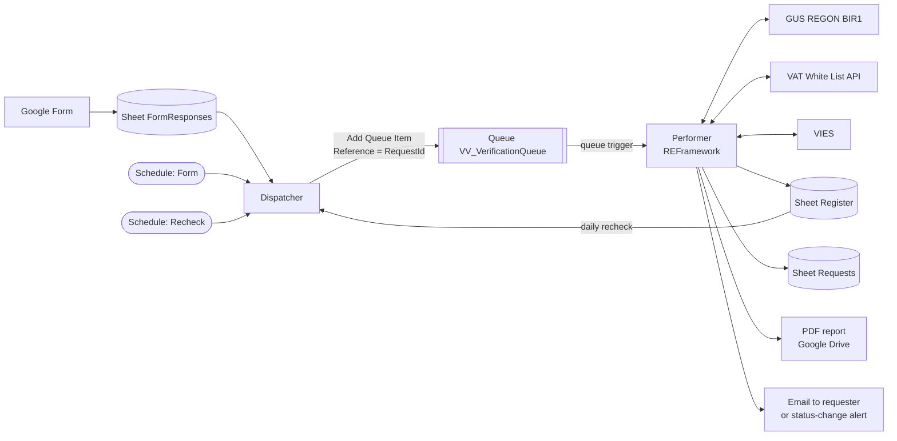
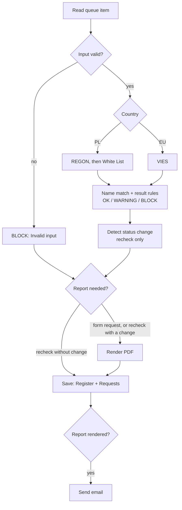

# 01 — Vendor verification

🇵🇱 [Wersja polska](README_PL.md)

Checks a vendor before it is added to the vendor master and rechecks every registered vendor daily. Polish vendors are checked in the VAT White List (Biała lista VAT) and the GUS REGON register, EU vendors in VIES. The robot compares the official name with the entered one, gives a result **OK / WARNING / BLOCK** with reasons, saves it to a vendor register, renders a PDF report and emails the requester.

## Business context

In Poland, a buyer who pays an invoice of **15 000 PLN gross or more** to an active VAT payer's bank account that is **not on the VAT White List** becomes **jointly liable for the vendor's VAT** (art. 117ba of the Tax Ordinance). The liability can be avoided only by paying via split payment (MPP) or by filing a **ZAW-NR** notification within **7 days** of the transfer. *(The additional sanction — losing the right to book the cost as tax-deductible — is being repealed for invoices issued from 2027; joint VAT liability stays.)*

So before a vendor is used, accounts payable checks:

- the VAT status and the bank account in the White List;
- that the company exists and is active (REGON);
- for EU vendors, that the VAT number is valid (VIES);
- that the name on the request matches the official name.

Done by hand, this means several websites per vendor and no audit trail. Vendor statuses change over time, so the check has to be repeated. The pre-payment check of a specific invoice on its payment date belongs to scenario 03; this project maintains the vendor register.

## What the robot does

1. A requester fills in the Google Form **Vendor Verification Request**: vendor name, country, NIP, VAT ID, IBAN.
2. **Dispatcher** reads new form responses and adds one queue item per request. Once a day it also queues every vendor from the register for a **recheck**.
3. **Performer** (REFramework) processes one request per transaction:
   - validates the input (NIP and IBAN checksums, VAT ID format and country prefix);
   - Polish vendors: **GUS REGON** (official name, address, end of activity) and **VAT White List** (VAT status, is the IBAN on the list);
   - EU vendors: **VIES** (VAT number validity, name and address where the country provides them);
   - compares the entered name with the official one;
   - sets the result **OK / WARNING / BLOCK** with all reasons;
   - for a recheck, detects a change of the result or VAT status since the last check.
4. Saves the result to the **Register** (one row per vendor) and **Requests** (one row per request) sheets, renders a **PDF report** from a Google Docs template and **emails** the requester with the PDF attached. A recheck sends an alert only when something changed.



One transaction in the Performer:



## Result rules

The result is the strictest level of all triggered rules; the reason lists every rule (blocks, then warnings, then notes). Without reasons it is `All checks passed`.

| Result | Rule |
|---|---|
| **BLOCK** | Invalid input (NIP / IBAN checksum, missing NIP for PL, missing or foreign-prefixed VAT ID for EU, unsupported country) |
| **BLOCK** | PL: VAT status `NotRegistered` (removed from or refused VAT registration) |
| **BLOCK** | PL: not found in the White List **and** not found in REGON |
| **BLOCK** | REGON: activity ended |
| **BLOCK** | EU: VAT ID not valid in VIES |
| **BLOCK** | PL: active VAT payer and the IBAN is **not** on the White List → *do not pay to this account; pay via MPP; if already paid, file ZAW-NR within 7 days* |
| WARNING | PL: not in the White List but found in REGON → not a VAT payer, the 15 000 PLN rule does not apply, check that invoices carry no VAT |
| WARNING | PL: VAT-exempt and the IBAN is not on the White List (no sanction, verify the account) |
| WARNING | Name similarity below the threshold (0.8) |
| WARNING | Name cannot be verified (PL not found in REGON; EU country that does not publish names in VIES, e.g. Germany) |
| note | VAT-exempt vendor; IBAN not provided (the account is checked at payment time) |

**Name match.** Both names are normalised (upper case, diacritics removed, punctuation, domains and legal forms such as `SPÓŁKA AKCYJNA`, `SP. Z O.O.`, `GMBH`, `S.A R.L.` stripped). The score is the Dice coefficient on words — 2 × matching words / (words in both names); a word matches exactly or as a prefix (`EU` → `EUROPE`). Names written together (`CDProjekt` = `CD PROJEKT`) score 1.00. Abbreviations and brands (`PZU SA`, `PKO`, `Bank Pekao`) score low and give a WARNING on purpose: a false WARNING is cheaper than a false OK.

## Architecture

Two UiPath projects (Windows, C#), library `UipathDev.Shared` 1.0.0:

| Project | Type | Role |
|---|---|---|
| `Dispatcher/` → `UipathDev.VendorVerification.Dispatcher` | Process | Argument `in_Mode`: `Form` reads form responses of the last `in_LookbackDays` (7) days; `Recheck` reads the Register. Adds queue items, writes nothing to Google |
| `Performer/` → `UipathDev.VendorVerification.Performer` | Process (REFramework) | All checks; the only writer of the `Requests` and `Register` sheets |

Design decisions:

- **Deterministic `RequestId` = queue Reference** (queue with *Enforce unique references*): form request `VR-yyyyMMdd-HHmmss-XXXX` (timestamp + 4 hex of SHA-256 of the response), recheck `RC-yyyyMMdd-<VendorId>` (one per vendor per day). The Dispatcher can run any number of times without creating duplicates; it skips references already in the queue before adding.
- **Invalid input is a result, not an exception**: the requester gets `BLOCK: Invalid input: …` with all errors in one email, and the queue item is Successful. Failed items mean only "the robot could not check".
- **Register key `VendorId`** = EU-format VAT ID (`PL7740001454`, `DE143454214`) — EU vendors have no NIP. Invalid requests are not written to the Register.
- **REGON before the White List**: REGON has no daily limit, so a REGON failure and queue retry do not consume White List searches (~100 per day per IP).
- **One time per transaction** (Europe/Warsaw, explicit time zone): the same timestamp in the sheets, the PDF and the email.
- **Idempotent completion order**: render PDF → save Register → save Requests → send email. A retry after a failure does not duplicate rows or files; the email is sent only after everything is saved.
- **Recheck** stores the previous `Result` and `VatStatus` in the queue item; the Performer compares and, on a change, renders the PDF and sends an alert to `VV_NotifyEmail`. Without a change — no PDF, no email.

## Exceptions and retries

| Situation | Handling |
|---|---|
| Broken queue item (missing fields, RequestId ≠ Reference) | Business exception → Failed, no retry |
| White List HTTP 400 (other than WL-196) | Business exception → Failed |
| White List database update `WL-196` (daily ~22:00–00:00) or daily limit HTTP 429 | **Postpone** the queue item until the next 00:30 (Warsaw) |
| VIES unavailable (`MS_UNAVAILABLE`, `*_MAX_CONCURRENT_REQ`, HTTP error) after 3 attempts × 15 s | **Postpone** by 1 hour |
| Still unavailable 48 h after the request | Business exception → Failed ("gave up") |
| REGON, Google Sheets / Docs / Drive / Gmail errors, anything unexpected | System exception → queue retries the item up to 3 times |
| 3 system exceptions in a row | Job stops as Faulted (`MaxConsecutiveSystemExceptions = 3`) |
| Invalid requester email address | Result is sent to `VV_NotifyEmail`, subject marked `requester address invalid` |

Postponed items go back to *New* with a defer date; the retry counter does not grow and they are not counted as consecutive failures. `SetTransactionStatus.xaml` of the framework was extended with this branch. Alerts about failed items, faulted jobs and disabled triggers are Orchestrator alert subscriptions.

## Google resources

| Resource | Content |
|---|---|
| Form `Vendor Verification Request` | Responder email; `Vendor name`, `Country` (27 VIES codes, Greece = `EL`), `NIP`, `VAT ID`, `IBAN`. No validation in the form — the robot validates |
| Spreadsheet `VendorRequests` | Sheet `FormResponses` (written by Google Forms; NIP / VAT ID / IBAN columns as Text), sheet `Requests` (Performer): `RequestId, Timestamp, RequestedBy, VendorName, Country, Nip, VatId, Iban, Status, Result, ResultReason, ReportPdfId, ProcessedAt` |
| Spreadsheet `VendorRegister` | Sheet `Register` (Performer, key `VendorId`): `VendorId, Country, Nip, VatId, VendorName, Iban, VatStatus, IbanOnWhiteList, ViesValid, OfficialName, OfficialAddress, NameSource, Result, ResultReason, WhiteListRequestId, LastRequestId, CheckedAt` |
| Docs template `VendorCheckReport` | 16 placeholders `{{RequestId}}`, `{{ProcessedAt}}`, `{{Result}}`, `{{ResultReason}}`, vendor data, check results, `{{NameScore}}` |
| Drive folder `reports/` | `<RequestId>.pdf` and the rendered Doc for every report |

The robot sheets are Plain text, locale United States, time zone Warsaw; the robot writes times as `yyyy-MM-dd HH:mm:ss`. `WhiteListRequestId` is the White List `requestId` (`searchId` or `searchId;checkId`) — proof of the check for an audit.

## Orchestrator resources

| Resource | Name / value |
|---|---|
| Queue | `VV_VerificationQueue` — Enforce unique references = Yes, Auto retry = Yes, Max # retries = 3 |
| Assets (Text) | `VV_RequestsSheetId`, `VV_RegisterSheetId`, `VV_ReportsFolderId`, `VV_ReportTemplateId`, `VV_NotifyEmail` |
| Asset (Credential) | `VV_RegonApiKey` — GUS BIR1 API key in the password |
| Integration Service | Google Sheets, Google Docs, Google Drive, Gmail (robot account) |
| Triggers | Queue trigger → Performer (max 1 pending/running job — one writer per sheet); daily time trigger → Dispatcher `Form`; daily time trigger → Dispatcher `Recheck` (`in_Mode = Recheck`) |
| Alerts | Subscriptions: job faulted, queue item failed (application / business), trigger disabled |

Assets are read once at start-up (`InitAllSettings`) and are not logged.

`Performer/Data/Config.json`:

| Key | Value |
|---|---|
| `Settings.logF_BusinessProcessName` | `VendorVerification` |
| `Settings.RegonServiceUrl` | BIR1 service URL (test or production — must match the key) |
| `Settings.NameMatchThreshold` | `0.8` |
| `Constants.MaxRetryNumber` | `0` (retries are done by the queue) |
| `Constants.MaxConsecutiveSystemExceptions` | `3` |
| `Constants.ShouldMarkJobAsFaulted` | `true` |

## External services

| Service | Interface | Used for |
|---|---|---|
| VAT White List (Ministry of Finance) | REST `wl-api.mf.gov.pl` — `search` by NIP, `check` NIP + account for virtual accounts | VAT status, IBAN on the list, request ID; library activity `CheckVatWhiteList` |
| GUS REGON BIR1 | SOAP 1.2 + WS-Addressing, session `Zaloguj` → `DaneSzukajPodmioty` → `Wyloguj`, MTOM response | Official name and address, end of activity |
| VIES (European Commission) | REST `ec.europa.eu/taxation_customs/vies/rest-api` | EU VAT number validity, name, address |

## Demo data and results

`data/demo-requests.csv` — 20 cases with the expected result: active vendor with the account on the list, `NotRegistered` (PZU), name-match boundary cases (CD PROJEKT, Amazon EU), brands and abbreviations (Bank Pekao, PKO), NIP of another company (Orlen Paliwa → Orange Polska), account not on the list with virtual accounts (Allegro), unknown NIP, six invalid inputs, valid / invalid / nameless VIES numbers.

End-to-end run on 2026-11-22 (form → Dispatcher → queue → unattended Performer):

- **18 of 20** results as expected; **2** (ORLEN, cases 1 and 14) give WARNING instead of OK because of the REGON test database (see Limitations).
- ≈ **22 s** per form request including the PDF and the email; ≈ **5 s** per recheck without changes.
- Daily recheck of 13 vendors: no status changes, no reports or emails.
- 18 White List requests for the whole run — far below the daily limit.

There are no automated tests: the rules were verified by the end-to-end run on the demo set. The library's pure functions (`ValidateNip`, `ValidateIban`) have their own test cases in `00-shared-library`.

## Running it

1. Publish `UipathDev.Shared` 1.0.0 to the tenant feed (see `00-shared-library`).
2. Create the Google resources above in the robot's Drive; set the column type of NIP / VAT ID / IBAN in `FormResponses` to Text before the first response (otherwise a 26-digit IBAN becomes a number).
3. Create the queue, Assets and Integration Service connections in the Orchestrator folder `uipath-dev`. For REGON, request a BIR1 key from GUS (or use the public test key with the test URL).
4. Open both projects in Studio, publish them, create the processes and triggers, connect an unattended robot.
5. Send a form response and run the Dispatcher (or wait for the schedule); the queue trigger starts the Performer.

## Project structure

```
01-vendor-verification/
├── README.md / README_PL.md
├── data/demo-requests.csv              # demo cases with expected results
├── Dispatcher/
│   ├── Main.xaml                        # mode switch: Form / Recheck
│   └── Steps/                           # DispatchFormResponses, DispatchRecheck
└── Performer/
    ├── Main.xaml, Framework/            # REFramework (SetTransactionStatus extended with Postpone)
    ├── Steps/                           # ReadRequest, ValidateRequest, CheckRegon, CallRegon, CheckWhiteList,
    │                                    # CheckVies, ThrowServiceUnavailable, NormalizeName, MatchVendorName,
    │                                    # EvaluateResult, DetectStatusChange, RenderReport, BuildSheetRow,
    │                                    # SaveResult, NotifyRequester
    └── Data/
        ├── Config.json
        └── Templates/                   # ResultEmail.html, StatusChangeAlert.html
```

## Limitations

- **REGON test database.** Until a production BIR1 key is issued, the robot uses the GUS test service: a 2014 snapshot with anonymised addresses (`ul. Test-…`). Some names differ from today's (ORLEN → false WARNING on the name), some companies are missing (Allegro → `Not found in REGON`). Production: put the key into `VV_RegonApiKey` and the production URL into `RegonServiceUrl`.
- **New form responses are picked up by schedule**, not by event: the Integration Service Google Forms connector (Preview) is blocked by Google for a regular Gmail account. Alternatives: a Google Sheets "Row Added" trigger on `FormResponses`, or an own OAuth app.
- **White List API limit** ~100 searches per day per IP, shared by form requests and the daily recheck. For large registers: the White List flat file (*plik płaski*) — planned for the library.
- **One Performer job at a time**: `SheetsUpsertByKey` reads and then writes the sheet, so two parallel writers would overwrite each other.
- **Google Docs API** ≈ 60 write requests per minute per user; one report takes 16. The library retries on 429. A copy of the rendered Doc stays in `reports/` next to the PDF.
- **EU IBANs** are only format-checked (there is no White List equivalent).
- **VIES** gives no request identifier without requester data (the demo company has no VAT ID); the check is evidenced by `CheckedAt` and the log.
- **Postponed transactions** leave `[Error]` entries with a stack trace in the log at every Invoke level — this is how the robot logs exceptions, the final entry is `Transaction postponed`.
- **Alerts** go to the Orchestrator account email, not to `VV_NotifyEmail`.
- **Demo deployment**: one Community unattended robot on a Windows 11 Home laptop; background jobs run in the user's session, so the robot works while the user is signed in. Production: a dedicated robot account on Windows Server / Pro or a cloud robot.
- A syntactically valid but non-existent requester address results in a bounce in the robot's mailbox.

## Possible extensions

- VIES and REGON activities and the name match moved to the shared library (when scenario 03 needs them).
- White List flat file for the daily recheck of the whole register.
- AI second opinion for names below the threshold (UiPath GenAI), added to the WARNING reason without changing the result.
- Event trigger on new form responses.
