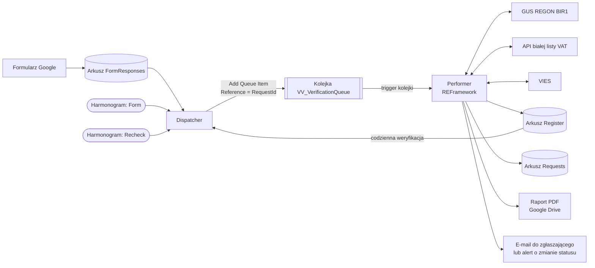
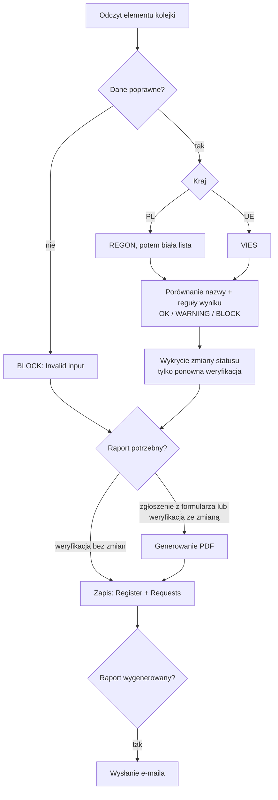

# 01 — Weryfikacja kontrahentów

🇬🇧 [English version](README.md)

Sprawdza kontrahenta przed dodaniem go do kartoteki dostawców i codziennie ponownie weryfikuje każdego kontrahenta z rejestru. Polskich kontrahentów sprawdza na białej liście podatników VAT i w rejestrze GUS REGON, unijnych — w VIES. Robot porównuje nazwę oficjalną z wpisaną, wystawia wynik **OK / WARNING / BLOCK** z uzasadnieniem, zapisuje go w rejestrze kontrahentów, generuje raport PDF i wysyła e-mail do zgłaszającego.

## Kontekst biznesowy

Nabywca, który zapłaci fakturę na kwotę **co najmniej 15 000 zł brutto** czynnemu podatnikowi VAT na rachunek **spoza białej listy**, odpowiada **solidarnie za VAT dostawcy** (art. 117ba Ordynacji podatkowej). Odpowiedzialności można uniknąć tylko płacąc w mechanizmie podzielonej płatności (MPP) albo składając zawiadomienie **ZAW-NR** w ciągu **7 dni** od przelewu. *(Dodatkowa sankcja — utrata prawa do zaliczenia wydatku do kosztów uzyskania przychodu — jest uchylana dla faktur wystawionych od 2027 roku; solidarna odpowiedzialność za VAT pozostaje.)*

Dlatego zanim kontrahent zostanie użyty, dział płatności sprawdza:

- status VAT i rachunek bankowy na białej liście;
- czy firma istnieje i działa (REGON);
- dla kontrahentów z UE — czy numer VAT jest aktywny (VIES);
- czy nazwa w zgłoszeniu zgadza się z nazwą oficjalną.

Ręcznie oznacza to kilka serwisów na każdego kontrahenta i brak śladu audytowego. Statusy kontrahentów zmieniają się w czasie, więc kontrolę trzeba powtarzać. Kontrola konkretnej faktury na dzień płatności należy do scenariusza 03; ten projekt prowadzi rejestr kontrahentów.

## Co robi robot

1. Zgłaszający wypełnia formularz Google **Vendor Verification Request**: nazwa kontrahenta, kraj, NIP, numer VAT UE, IBAN.
2. **Dispatcher** odczytuje nowe odpowiedzi formularza i dodaje jeden element kolejki na każde zgłoszenie. Raz dziennie dodaje też do kolejki wszystkich kontrahentów z rejestru do **ponownej weryfikacji**.
3. **Performer** (REFramework) obsługuje jedno zgłoszenie na transakcję:
   - waliduje dane wejściowe (sumy kontrolne NIP i IBAN, format numeru VAT UE i prefiks kraju);
   - polscy kontrahenci: **GUS REGON** (nazwa oficjalna, adres, zakończenie działalności) i **biała lista VAT** (status VAT, czy IBAN jest na liście);
   - kontrahenci z UE: **VIES** (ważność numeru VAT, nazwa i adres, jeśli kraj je udostępnia);
   - porównuje wpisaną nazwę z oficjalną;
   - wystawia wynik **OK / WARNING / BLOCK** ze wszystkimi powodami;
   - przy ponownej weryfikacji wykrywa zmianę wyniku lub statusu VAT od poprzedniego sprawdzenia.
4. Zapisuje wynik w arkuszach **Register** (jeden wiersz na kontrahenta) i **Requests** (jeden wiersz na zgłoszenie), generuje **raport PDF** z szablonu Google Docs i **wysyła e-mail** do zgłaszającego z PDF w załączniku. Ponowna weryfikacja wysyła alert tylko wtedy, gdy coś się zmieniło.



Jedna transakcja w Performerze:



## Reguły wyniku

Wynikiem jest najsurowszy poziom spośród spełnionych reguł; uzasadnienie wymienia każdą regułę (blokady, potem ostrzeżenia, potem uwagi). Bez powodów wynik to `All checks passed`.

| Wynik | Reguła |
|---|---|
| **BLOCK** | Niepoprawne dane (suma kontrolna NIP / IBAN, brak NIP dla PL, brak numeru VAT UE lub prefiks innego kraju dla UE, nieobsługiwany kraj) |
| **BLOCK** | PL: status VAT `NotRegistered` (wykreślony lub niezarejestrowany jako podatnik VAT) |
| **BLOCK** | PL: brak na białej liście **i** brak w REGON |
| **BLOCK** | REGON: zakończenie działalności |
| **BLOCK** | UE: numer VAT nieaktywny w VIES |
| **BLOCK** | PL: czynny podatnik VAT, a IBAN **nie** jest na białej liście → *nie płacić na ten rachunek; płacić w MPP; jeśli już zapłacono — złożyć ZAW-NR w ciągu 7 dni* |
| WARNING | PL: brak na białej liście, ale jest w REGON → nie jest podatnikiem VAT, reguła 15 000 zł nie ma zastosowania, sprawdzić, czy faktury nie zawierają VAT |
| WARNING | PL: podatnik zwolniony, a IBAN nie jest na białej liście (bez sankcji, zweryfikować rachunek) |
| WARNING | Podobieństwo nazwy poniżej progu (0,8) |
| WARNING | Nie da się zweryfikować nazwy (PL — brak w REGON; kraj UE, który nie publikuje nazw w VIES, np. Niemcy) |
| uwaga | Podatnik zwolniony; IBAN nie podany (rachunek jest sprawdzany przy płatności) |

**Porównanie nazwy.** Obie nazwy są normalizowane (wielkie litery, bez polskich znaków, bez interpunkcji, domen i form prawnych takich jak `SPÓŁKA AKCYJNA`, `SP. Z O.O.`, `GMBH`, `S.A R.L.`). Wynik to współczynnik Dice'a na słowach — 2 × zgodne słowa / (słowa w obu nazwach); słowo zgadza się dokładnie lub jako prefiks (`EU` → `EUROPE`). Nazwy pisane łącznie (`CDProjekt` = `CD PROJEKT`) dają 1,00. Skróty i marki (`PZU SA`, `PKO`, `Bank Pekao`) dają niski wynik i celowo kończą się ostrzeżeniem: fałszywy WARNING kosztuje mniej niż fałszywe OK.

## Architektura

Dwa projekty UiPath (Windows, C#), biblioteka `UipathDev.Shared` 1.0.0:

| Projekt | Typ | Rola |
|---|---|---|
| `Dispatcher/` → `UipathDev.VendorVerification.Dispatcher` | Process | Argument `in_Mode`: `Form` odczytuje odpowiedzi formularza z ostatnich `in_LookbackDays` (7) dni; `Recheck` odczytuje rejestr. Dodaje elementy kolejki, nic nie zapisuje w Google |
| `Performer/` → `UipathDev.VendorVerification.Performer` | Process (REFramework) | Wszystkie kontrole; jedyny zapisujący arkusze `Requests` i `Register` |

Decyzje projektowe:

- **Deterministyczny `RequestId` = Reference elementu kolejki** (kolejka z *Enforce unique references*): zgłoszenie z formularza `VR-yyyyMMdd-HHmmss-XXXX` (znacznik czasu + 4 znaki hex z SHA-256 odpowiedzi), ponowna weryfikacja `RC-yyyyMMdd-<VendorId>` (jedna na kontrahenta dziennie). Dispatcher można uruchamiać dowolnie wiele razy bez duplikatów; przed dodaniem pomija referencje, które już są w kolejce.
- **Niepoprawne dane to wynik, a nie wyjątek**: zgłaszający dostaje `BLOCK: Invalid input: …` ze wszystkimi błędami w jednym e-mailu, a element kolejki ma status Successful. Status Failed oznacza wyłącznie „robot nie mógł sprawdzić”.
- **Klucz rejestru `VendorId`** = numer VAT w formacie UE (`PL7740001454`, `DE143454214`) — kontrahenci z UE nie mają NIP. Zgłoszenia z niepoprawnymi danymi nie trafiają do rejestru.
- **REGON przed białą listą**: REGON nie ma dziennego limitu, więc jego awaria i ponowienie z kolejki nie zużywają zapytań do białej listy (~100 dziennie z jednego IP).
- **Jeden czas na transakcję** (Europe/Warsaw, jawna strefa czasowa): ten sam znacznik w arkuszach, w PDF i w e-mailu.
- **Idempotentna kolejność zakończenia**: PDF → zapis Register → zapis Requests → e-mail. Ponowienie po błędzie nie dubluje wierszy ani plików; e-mail wychodzi dopiero po zapisaniu wszystkiego.
- **Ponowna weryfikacja** przekazuje w elemencie kolejki poprzednie `Result` i `VatStatus`; Performer je porównuje i przy zmianie generuje PDF oraz wysyła alert na `VV_NotifyEmail`. Bez zmian — bez PDF i bez e-maila.

## Wyjątki i ponowienia

| Sytuacja | Obsługa |
|---|---|
| Uszkodzony element kolejki (brak pól, RequestId ≠ Reference) | Wyjątek biznesowy → Failed, bez ponowienia |
| Biała lista HTTP 400 (inny niż WL-196) | Wyjątek biznesowy → Failed |
| Aktualizacja bazy białej listy `WL-196` (codziennie ok. 22:00–00:00) lub dzienny limit HTTP 429 | **Odroczenie** (Postpone) elementu do najbliższej 00:30 (czas warszawski) |
| VIES niedostępny (`MS_UNAVAILABLE`, `*_MAX_CONCURRENT_REQ`, błąd HTTP) po 3 próbach × 15 s | **Odroczenie** o 1 godzinę |
| Nadal niedostępny 48 h od zgłoszenia | Wyjątek biznesowy → Failed („gave up”) |
| Błędy REGON, Google Sheets / Docs / Drive / Gmail, wszystko nieoczekiwane | Wyjątek systemowy → kolejka ponawia element do 3 razy |
| 3 wyjątki systemowe z rzędu | Zadanie kończy się jako Faulted (`MaxConsecutiveSystemExceptions = 3`) |
| Niepoprawny adres e-mail zgłaszającego | Wynik trafia na `VV_NotifyEmail`, temat z dopiskiem `requester address invalid` |

Odroczone elementy wracają do stanu *New* z datą odroczenia; licznik ponowień nie rośnie i nie są liczone jako kolejne błędy. W tym celu rozszerzono `SetTransactionStatus.xaml` frameworka. Alerty o nieudanych elementach, zadaniach Faulted i wyłączonych triggerach to subskrypcje alertów Orchestratora.

## Zasoby Google

| Zasób | Zawartość |
|---|---|
| Formularz `Vendor Verification Request` | E-mail zgłaszającego; `Vendor name`, `Country` (27 kodów VIES, Grecja = `EL`), `NIP`, `VAT ID`, `IBAN`. Bez walidacji w formularzu — waliduje robot |
| Arkusz `VendorRequests` | Karta `FormResponses` (zapisuje Google Forms; kolumny NIP / VAT ID / IBAN jako tekst), karta `Requests` (Performer): `RequestId, Timestamp, RequestedBy, VendorName, Country, Nip, VatId, Iban, Status, Result, ResultReason, ReportPdfId, ProcessedAt` |
| Arkusz `VendorRegister` | Karta `Register` (Performer, klucz `VendorId`): `VendorId, Country, Nip, VatId, VendorName, Iban, VatStatus, IbanOnWhiteList, ViesValid, OfficialName, OfficialAddress, NameSource, Result, ResultReason, WhiteListRequestId, LastRequestId, CheckedAt` |
| Szablon Docs `VendorCheckReport` | 16 symboli zastępczych `{{RequestId}}`, `{{ProcessedAt}}`, `{{Result}}`, `{{ResultReason}}`, dane kontrahenta, wyniki kontroli, `{{NameScore}}` |
| Folder Drive `reports/` | `<RequestId>.pdf` i wygenerowany dokument Docs dla każdego raportu |

Arkusze robota mają format zwykłego tekstu, ustawienia regionalne United States i strefę czasową Warszawy; robot zapisuje czas jako `yyyy-MM-dd HH:mm:ss`. `WhiteListRequestId` to `requestId` białej listy (`searchId` lub `searchId;checkId`) — dowód sprawdzenia na potrzeby audytu.

## Zasoby Orchestratora

| Zasób | Nazwa / wartość |
|---|---|
| Kolejka | `VV_VerificationQueue` — Enforce unique references = Yes, Auto retry = Yes, Max # retries = 3 |
| Assety (Text) | `VV_RequestsSheetId`, `VV_RegisterSheetId`, `VV_ReportsFolderId`, `VV_ReportTemplateId`, `VV_NotifyEmail` |
| Asset (Credential) | `VV_RegonApiKey` — klucz API GUS BIR1 w polu hasła |
| Integration Service | Google Sheets, Google Docs, Google Drive, Gmail (konto robota) |
| Triggery | Trigger kolejki → Performer (maks. 1 oczekujące/uruchomione zadanie — jeden zapisujący na arkusz); codzienny trigger czasowy → Dispatcher `Form`; codzienny trigger czasowy → Dispatcher `Recheck` (`in_Mode = Recheck`) |
| Alerty | Subskrypcje: zadanie Faulted, element kolejki Failed (application / business), trigger wyłączony |

Assety są odczytywane raz przy starcie (`InitAllSettings`) i nie trafiają do logów.

`Performer/Data/Config.json`:

| Klucz | Wartość |
|---|---|
| `Settings.logF_BusinessProcessName` | `VendorVerification` |
| `Settings.RegonServiceUrl` | URL usługi BIR1 (testowy lub produkcyjny — musi pasować do klucza) |
| `Settings.NameMatchThreshold` | `0.8` |
| `Constants.MaxRetryNumber` | `0` (ponowienia realizuje kolejka) |
| `Constants.MaxConsecutiveSystemExceptions` | `3` |
| `Constants.ShouldMarkJobAsFaulted` | `true` |

## Usługi zewnętrzne

| Usługa | Interfejs | Do czego |
|---|---|---|
| Biała lista podatników VAT (Ministerstwo Finansów) | REST `wl-api.mf.gov.pl` — `search` po NIP, `check` NIP + rachunek dla rachunków wirtualnych | Status VAT, IBAN na liście, identyfikator zapytania; aktywność biblioteki `CheckVatWhiteList` |
| GUS REGON BIR1 | SOAP 1.2 + WS-Addressing, sesja `Zaloguj` → `DaneSzukajPodmioty` → `Wyloguj`, odpowiedź MTOM | Nazwa i adres oficjalny, zakończenie działalności |
| VIES (Komisja Europejska) | REST `ec.europa.eu/taxation_customs/vies/rest-api` | Ważność numeru VAT UE, nazwa, adres |

## Dane demonstracyjne i wyniki

`data/demo-requests.csv` — 20 przypadków z oczekiwanym wynikiem: czynny podatnik z rachunkiem na liście, `NotRegistered` (PZU), przypadki graniczne porównania nazwy (CD PROJEKT, Amazon EU), marki i skróty (Bank Pekao, PKO), NIP innej firmy (Orlen Paliwa → Orange Polska), rachunek spoza listy przy rachunkach wirtualnych (Allegro), nieznany NIP, sześć przypadków niepoprawnych danych, poprawne / niepoprawne / bez nazwy numery VIES.

Przebieg end-to-end 2026-11-22 (formularz → Dispatcher → kolejka → Performer unattended):

- **18 z 20** wyników zgodnych z oczekiwaniem; **2** (ORLEN, przypadki 1 i 14) dają WARNING zamiast OK z powodu testowej bazy REGON (zob. Ograniczenia).
- ≈ **22 s** na zgłoszenie z formularza łącznie z PDF i e-mailem; ≈ **5 s** na ponowną weryfikację bez zmian.
- Codzienna weryfikacja 13 kontrahentów: bez zmian statusu, bez raportów i e-maili.
- 18 zapytań do białej listy w całym przebiegu — daleko poniżej dziennego limitu.

Brak testów automatycznych: reguły zweryfikowano przebiegiem end-to-end na zestawie demonstracyjnym. Czyste funkcje biblioteki (`ValidateNip`, `ValidateIban`) mają własne przypadki testowe w `00-shared-library`.

## Uruchomienie

1. Opublikuj `UipathDev.Shared` 1.0.0 w feedzie tenanta (zob. `00-shared-library`).
2. Utwórz opisane wyżej zasoby Google na Dysku robota; przed pierwszą odpowiedzią ustaw typ kolumn NIP / VAT ID / IBAN w `FormResponses` na tekst (inaczej 26-cyfrowy IBAN zamieni się w liczbę).
3. Utwórz kolejkę, Assety i połączenia Integration Service w folderze Orchestratora `uipath-dev`. Dla REGON wystąp do GUS o klucz BIR1 (albo użyj publicznego klucza testowego z testowym adresem URL).
4. Otwórz oba projekty w Studio, opublikuj je, utwórz procesy i triggery, podłącz robota unattended.
5. Wyślij odpowiedź w formularzu i uruchom Dispatchera (albo poczekaj na harmonogram); trigger kolejki uruchomi Performera.

## Struktura projektu

```
01-vendor-verification/
├── README.md / README_PL.md
├── data/demo-requests.csv              # przypadki demonstracyjne z oczekiwanym wynikiem
├── Dispatcher/
│   ├── Main.xaml                        # wybór trybu: Form / Recheck
│   └── Steps/                           # DispatchFormResponses, DispatchRecheck
└── Performer/
    ├── Main.xaml, Framework/            # REFramework (SetTransactionStatus rozszerzony o Postpone)
    ├── Steps/                           # ReadRequest, ValidateRequest, CheckRegon, CallRegon, CheckWhiteList,
    │                                    # CheckVies, ThrowServiceUnavailable, NormalizeName, MatchVendorName,
    │                                    # EvaluateResult, DetectStatusChange, RenderReport, BuildSheetRow,
    │                                    # SaveResult, NotifyRequester
    └── Data/
        ├── Config.json
        └── Templates/                   # ResultEmail.html, StatusChangeAlert.html
```

## Ograniczenia

- **Testowa baza REGON.** Do czasu otrzymania produkcyjnego klucza BIR1 robot korzysta z usługi testowej GUS: to stan z 2014 roku z zanonimizowanymi adresami (`ul. Test-…`). Część nazw różni się od obecnych (ORLEN → fałszywe ostrzeżenie o nazwie), części firm brakuje (Allegro → `Not found in REGON`). Produkcyjnie: klucz w `VV_RegonApiKey` i produkcyjny URL w `RegonServiceUrl`.
- **Nowe odpowiedzi formularza są pobierane według harmonogramu**, a nie po zdarzeniu: konektor Google Forms w Integration Service (Preview) jest blokowany przez Google dla zwykłego konta Gmail. Alternatywy: trigger Google Sheets „Row Added” na `FormResponses` albo własna aplikacja OAuth.
- **Limit API białej listy** ok. 100 zapytań `search` dziennie z jednego IP, wspólny dla zgłoszeń i codziennej weryfikacji. Przy dużych rejestrach: plik płaski białej listy — planowany w bibliotece.
- **Jedno zadanie Performera naraz**: `SheetsUpsertByKey` odczytuje, a potem zapisuje arkusz, więc dwa równoległe zapisy nadpisałyby się nawzajem.
- **Google Docs API** ok. 60 zapytań zapisu na minutę na użytkownika; jeden raport to 16 zapytań. Biblioteka ponawia przy 429. Kopia wygenerowanego dokumentu Docs zostaje w `reports/` obok PDF.
- **IBAN-y z UE** są sprawdzane tylko pod kątem formatu (brak odpowiednika białej listy).
- **VIES** nie zwraca identyfikatora konsultacji bez danych pytającego (firma demonstracyjna nie ma numeru VAT); dowodem sprawdzenia są `CheckedAt` i log.
- **Odroczone transakcje** zostawiają w logu wpisy `[Error]` ze stosem wywołań na każdym poziomie Invoke — tak robot loguje wyjątki; ostatni wpis to `Transaction postponed`.
- **Alerty** trafiają na e-mail konta Orchestratora, a nie na `VV_NotifyEmail`.
- **Wdrożenie demonstracyjne**: jeden robot unattended (Community) na laptopie z Windows 11 Home; zadania w tle działają w sesji użytkownika, więc robot pracuje, dopóki użytkownik jest zalogowany. Produkcyjnie: osobne konto robota na Windows Server / Pro albo robot w chmurze.
- Poprawny składniowo, ale nieistniejący adres zgłaszającego kończy się zwrotem wiadomości (bounce) w skrzynce robota.

## Możliwe rozszerzenia

- Przeniesienie aktywności VIES i REGON oraz porównania nazw do wspólnej biblioteki (gdy będą potrzebne w scenariuszu 03).
- Plik płaski białej listy do codziennej weryfikacji całego rejestru.
- Druga opinia AI dla nazw poniżej progu (UiPath GenAI), dopisywana do powodu WARNING bez zmiany wyniku.
- Trigger zdarzeniowy na nowe odpowiedzi formularza.
